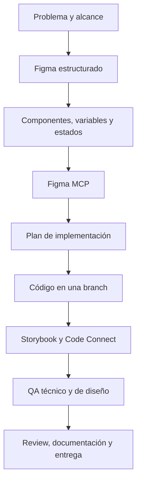
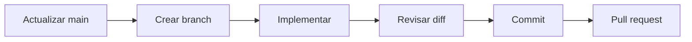

# De Figma a código con IA

## Guía operativa para UX/UI y Product Designers

**Versión:** 1.1  
**Actualización:** 6 de octubre de 2026  
**Audiencia:** UX/UI Designers, Product Designers y Design System Designers que quieren trabajar sobre productos reales sin convertirse primero en Frontend Developers.

---

## 1. Para qué sirve esta guía

Esta guía explica cómo pasar de una idea o un diseño en Figma a una implementación real asistida por IA, manteniendo el criterio de producto y diseño durante todo el proceso.

No enseña a programar una aplicación completa desde cero. Enseña a:

- preparar un archivo de Figma para que humanos e IA entiendan su estructura;
- usar IA dentro de Figma sin degradar el Design System;
- entregar diseños implementables, no solo capturas visuales;
- conectar Figma con componentes reales mediante MCP y Code Connect;
- trabajar de forma segura dentro de un repositorio;
- comprender por arriba el código generado;
- verificar fidelidad visual, comportamiento, accesibilidad y calidad técnica;
- colaborar con developers mediante Git y GitHub;
- registrar evidencia antes de afirmar que una tarea está terminada.

La idea central es:

> La IA puede ejecutar gran parte del trabajo. La persona conserva el criterio sobre qué construir, cómo debe comportarse y cuándo está realmente terminado.

---

## 2. El mapa completo



Cada etapa responde una pregunta distinta:

| Etapa | Pregunta |
|---|---|
| Problema | ¿Qué necesidad resolvemos y para quién? |
| Figma | ¿Qué debe verse y comportarse de qué manera? |
| Design System | ¿Qué se reutiliza, extiende o crea? |
| MCP | ¿Cómo recibe la IA el contexto estructurado? |
| Plan | ¿Qué archivos, estados y decisiones se necesitan? |
| Código | ¿Cómo se implementa dentro del producto real? |
| Storybook | ¿Cómo se revisa cada componente de forma aislada? |
| Code Connect | ¿Qué componente de Figma corresponde a qué componente de código? |
| QA | ¿Funciona, es accesible y conserva la intención del diseño? |
| Entrega | ¿Qué evidencia, documentación y cambios recibe el equipo? |

---

## 3. Tres formas de trabajar con IA

No todos los trabajos necesitan el mismo nivel de integración.

### 3.1 Exploración rápida

Usar un builder visual o generador separado del producto para probar una idea.

Sirve para:

- explorar conceptos;
- comparar direcciones;
- hacer prototipos descartables;
- validar una conversación temprana.

No es suficiente cuando el resultado debe incorporarse al producto real, porque puede no usar sus componentes, tokens, datos ni convenciones.

### 3.2 Agente trabajando sobre el repositorio

El agente abre el código real, inspecciona el Design System y modifica una branch controlada.

Sirve para:

- implementar componentes y pantallas reales;
- reutilizar la arquitectura existente;
- ejecutar verificaciones;
- preparar cambios revisables por el equipo.

Es el modo recomendado cuando el destino es producción.

### 3.3 In-system prototyping

Prototipar directamente con los componentes, tokens y estados reales del producto, normalmente usando Storybook o una ruta segura de desarrollo.

Sirve para:

- explorar sin separarse del sistema;
- validar contenido y comportamiento reales;
- reducir la diferencia entre prototipo e implementación.

Las tres opciones son válidas. La elección depende del destino del trabajo, no de cuál herramienta parezca más impresionante.

---

## 4. Qué necesitás para trabajar sobre una aplicación real

No necesitás credenciales de producción ni acceso irrestricto a toda la empresa. Sí necesitás un entorno autorizado y revisable.

### Accesos mínimos

- Archivo de Figma y librerías relevantes.
- Permiso adecuado para inspeccionar o editar.
- Repositorio de GitHub del producto o del Design System.
- Instrucciones de instalación y ejecución local.
- Una branch propia.
- Datos ficticios, entorno de prueba o fixtures seguros.
- Criterios de aceptación y una persona responsable para decisiones de producto.

### Herramientas habituales

- Figma Design y, cuando esté disponible, Dev Mode.
- Figma MCP conectado al agente.
- Claude Code, Codex, Cursor u otro agente autorizado.
- Git y GitHub.
- Storybook, si el proyecto lo utiliza.
- Code Connect, si el plan y la organización lo permiten.
- Navegador con herramientas de desarrollo.

### Nunca pedir ni copiar sin necesidad

- contraseñas personales;
- tokens dentro del chat o del código;
- archivos `.env` para publicar;
- datos reales de usuarios;
- acceso a producción para practicar;
- permisos de administración que la tarea no necesita.

---

## 5. Qué significa que un archivo de Figma esté preparado para IA

“AI-ready” no es un botón de Figma. Es la calidad de la estructura y de las decisiones que el archivo comunica.

Una IA interpreta mejor un diseño cuando encuentra:

- nombres semánticos;
- componentes e instancias reales;
- propiedades y variantes coherentes;
- Auto Layout;
- variables y estilos reutilizables;
- estados explícitos;
- contenido representativo;
- anotaciones sobre comportamiento;
- vínculos claros con el código.

Una captura perfecta visualmente puede ser una especificación muy pobre. Un archivo estructurado explica no solo cómo se ve la interfaz, sino también cómo está construida.

---

## 6. Cómo preparar Figma

### 6.1 Ordenar páginas y secciones

Una estructura posible:

```text
00 — Cover y contexto
01 — Foundations
02 — Components
03 — Patterns
04 — Flows
05 — Screens
06 — Ready for development
99 — Archive
```

No hace falta copiar estos nombres literalmente. Lo importante es que una persona nueva pueda encontrar la fuente correcta sin adivinar.

### 6.2 Nombrar capas por responsabilidad

Preferir:

- `Topbar`
- `SearchInput`
- `ProjectRow`
- `StatusBadge`
- `MetricCard`
- `ErrorMessage`

Evitar:

- `Frame 438`
- `Group 12`
- `Rectangle 91`
- `Copy 4`

El nombre debe explicar qué es el elemento, no cómo fue dibujado.

### 6.3 Usar componentes e instancias

Crear componentes cuando existe una pieza reutilizable con una responsabilidad clara.

Antes de crear uno nuevo, comprobar:

1. ¿Ya existe algo equivalente en Figma?
2. ¿Ya existe en código aunque no esté documentado en Figma?
3. ¿Conviene reutilizarlo sin cambios?
4. ¿Conviene extenderlo con una propiedad o variante real?
5. ¿La pieza es específica de una pantalla y debería permanecer interna?

No convertir cada grupo visual en un componente. La reutilización debe responder a un caso real.

### 6.4 Definir propiedades y variantes

Las propiedades más útiles suelen ser:

- texto;
- booleanos para mostrar u ocultar elementos;
- instance swap para iconos o subcomponentes;
- variantes para diferencias discretas y aprobadas;
- slots cuando la composición necesita contenido intercambiable.

Ejemplo conceptual para un botón:

```text
Button
├── variant: primary | secondary | ghost
├── size: small | medium | large
├── state: default | hover | pressed | disabled | loading
├── iconStart: opcional
└── label: texto
```

No crear combinaciones que nunca serán utilizadas. Cada variante aumenta el mantenimiento en Figma y código.

### 6.5 Usar Auto Layout y constraints con intención

Para cada contenedor, definir:

- dirección;
- separación;
- padding;
- alineación;
- `Hug`, `Fill` o tamaño fijo;
- ancho mínimo o máximo cuando corresponda;
- comportamiento al cambiar el contenido.

Después, redimensionar el frame. Si el diseño se rompe en Figma, la IA tampoco puede deducir una adaptación confiable.

### 6.6 Trabajar con variables y tokens

Una arquitectura práctica tiene tres niveles:

| Nivel | Ejemplo | Función |
|---|---|---|
| Primitivo | `blue-600` | Valor base |
| Semántico | `color-action-primary` | Intención de uso |
| Componente | `button-primary-background` | Decisión específica, solo si es necesaria |

En componentes y pantallas conviene consumir tokens semánticos. El código `#2563EB` explica un color; `color-action-primary` explica una decisión.

Registrar modos relevantes, por ejemplo:

- light y dark;
- desktop y compact, si el sistema los modela así;
- marca A y marca B;
- densidad confortable y densa.

No afirmar que Figma y código están “sincronizados” solo porque usan nombres parecidos. Sin una automatización bidireccional o una fuente de verdad gobernada, existe un mapeo, no una sincronización automática.

### 6.7 Diseñar estados, no solo el estado ideal

Según la funcionalidad, revisar:

- default;
- hover;
- focus visible;
- pressed o active;
- disabled;
- loading;
- success;
- error y reintento;
- vacío inicial;
- sin resultados por filtro;
- blocked o sin permisos;
- datos parciales;
- contenido corto, largo y extremo.

No todos los componentes necesitan todos los estados. Los necesarios dependen del comportamiento real.

### 6.8 Documentar responsive explícitamente

Un frame desktop no demuestra cómo funciona mobile.

Definir, cuando corresponda:

- qué se apila;
- qué cambia de orden;
- qué se oculta o resume;
- qué conserva ancho fijo;
- cómo se transforma la navegación;
- qué ocurre con tablas;
- cuáles son los límites de contenido;
- si los breakpoints provienen del sistema existente.

### 6.9 Incorporar accesibilidad desde el diseño

Revisar como mínimo:

- contraste;
- orden de lectura;
- jerarquía de encabezados;
- tamaño y área de interacción;
- foco visible;
- navegación por teclado;
- etiquetas de campos;
- mensajes de error comprensibles;
- información no comunicada solo mediante color;
- comportamiento con zoom y texto grande.

El plugin o la IA puede detectar problemas, pero la aprobación final requiere criterio humano y, en código, evidencia de runtime.

### 6.10 Agregar anotaciones de comportamiento

Anotar lo que no puede deducirse visualmente:

- qué sucede al hacer clic;
- qué datos se filtran;
- qué parte se actualiza;
- qué persiste al navegar;
- qué mensaje aparece ante un error;
- qué rol tiene permiso;
- qué acción es reversible;
- si existe confirmación;
- qué queda fuera del alcance.

### 6.11 Marcar “Ready for development” con criterio

Una pantalla está lista cuando:

- el flujo y el alcance fueron aprobados;
- los componentes se identificaron;
- los estados necesarios existen o están documentados;
- responsive está definido o explícitamente fuera de alcance;
- el contenido es representativo;
- no hay decisiones materiales ocultas;
- las diferencias respecto del Design System están justificadas.

---

## 7. Usar IA dentro de Figma

La IA puede ayudar a:

- auditar y renombrar capas;
- organizar jerarquías;
- detectar elementos repetidos;
- convertir valores crudos en variables;
- ensamblar pantallas con componentes existentes;
- crear ejemplos de contenido y estados;
- generar diagramas editables;
- documentar componentes;
- comparar un frame con reglas del Design System;
- preparar un archivo para implementación.

No debería decidir sola:

- qué problema de producto resolver;
- qué comportamiento es correcto cuando falta especificación;
- qué deuda de accesibilidad aceptar;
- qué dependencia incorporar;
- si un componente nuevo merece existir;
- si un cambio está listo para producción.

### Prompt base para modificar Figma

```text
Usá este archivo/selection de Figma: [URL].

Objetivo: [resultado observable].

Reutilizá los componentes y variables publicados del Design System.
No crees componentes ni variables nuevas sin mostrarme primero qué falta y por qué.
Conservá Auto Layout, nombres semánticos y propiedades existentes.
No inventes estados o comportamiento ausentes: registralos como decisiones pendientes.

Antes de modificar:
1. resumí lo que encontraste;
2. proponé el plan;
3. indicá qué vas a reutilizar, extender o crear;
4. esperá mi aprobación.
```

---

## 8. Figma MCP explicado en simple

MCP es el puente que permite que un agente consulte Figma de forma estructurada.

En lugar de recibir solamente una imagen, el agente puede obtener información como:

- componentes e instancias;
- propiedades y variantes;
- variables;
- estilos;
- estructura de capas;
- Auto Layout y medidas;
- datos del nodo seleccionado.

Figma MCP no “contiene el código” de la pantalla. Entrega contexto de diseño; el agente genera o modifica código utilizando ese contexto y el repositorio.

Las capacidades actuales también pueden escribir contenido editable en Figma, siempre que el plan, el asiento, los permisos y el cliente lo permitan. Como estas capacidades evolucionan, hay que comprobar la documentación oficial antes de configurar un equipo.

### Flujo recomendado

1. Conectar el servidor MCP remoto siguiendo la documentación del cliente.
2. Instalar o habilitar las skills oficiales de Figma.
3. Compartir la URL del archivo o de la selección exacta.
4. Pedir primero inspección, no implementación.
5. Verificar qué nodo leyó el agente.
6. Separar evidencia de Figma, decisiones aprobadas y suposiciones.
7. Recién después planificar cambios.

### Prompts útiles

```text
Inspeccioná esta selección de Figma y describí:
- componentes e instancias;
- propiedades y variantes;
- variables y estilos;
- Auto Layout y constraints;
- estados visibles;
- decisiones que no pueden deducirse del frame.

No escribas código todavía.
```

```text
Auditá esta pantalla contra la librería publicada. Clasificá cada región como:
- reutilizar;
- extender;
- crear;
- mantener interna de la pantalla.

Mostrame la evidencia antes de proponer implementación.
```

---

## 9. Code Connect explicado en simple

Code Connect vincula un componente publicado de Figma con su implementación real en el repositorio.

Ejemplo:

```text
Button de Figma ↔ src/components/ui/Button/Button.tsx
```

En Dev Mode, esa conexión permite mostrar referencias y ejemplos del componente real en lugar de depender solamente de código generado por apariencia.

### Beneficios

- reduce la búsqueda manual del componente correcto;
- ayuda a que agentes y developers reutilicen en vez de duplicar;
- muestra imports y snippets consistentes;
- puede mapear propiedades de Figma a props de código;
- vuelve visible la relación entre diseño y producto.

### Lo que Code Connect no hace

- no sincroniza automáticamente Figma y React;
- no verifica que ambos se vean idénticos;
- no prueba hover, teclado, datos ni errores;
- no reemplaza Storybook;
- no reemplaza el QA;
- no convierte cualquier diseño en producción.

### Requisitos y precauciones

- El componente de Figma debe estar publicado en una librería.
- Se debe mapear el componente o component set correcto, no una copia o variante suelta.
- La instancia usada en la pantalla debe derivar del componente publicado.
- El import debe apuntar al componente real.
- Las propiedades deben mapearse de forma coherente.
- La conexión debe verificarse sobre una instancia real en Dev Mode.
- La disponibilidad depende del plan de Figma; hay que revisar los requisitos actuales.

### Formato actual

Para proyectos nuevos, consultar el flujo de **template files** de Code Connect. Los parsers específicos por framework utilizados históricamente, incluidos muchos archivos `.figma.tsx`, son un enfoque legado que Figma dejó de mantener activamente. No migrar un proyecto existente a ciegas: auditar primero su configuración y seguir la guía oficial vigente.

### Checklist de verificación

- [ ] El componente está publicado.
- [ ] Se usó el nodo raíz o component set correcto.
- [ ] El archivo de Code Connect valida localmente.
- [ ] El import coincide con la ruta real.
- [ ] Variantes y propiedades importantes están mapeadas.
- [ ] El template fue publicado.
- [ ] Dev Mode muestra `hasTemplate` o evidencia equivalente.
- [ ] La instancia de una pantalla real resuelve al componente correcto.
- [ ] No existen mapeos viejos o duplicados.

---

## 10. Storybook: el laboratorio del componente

Storybook permite revisar componentes de forma aislada del resto de la aplicación.

Una story útil puede mostrar:

- variantes;
- tamaños;
- estados;
- loading y disabled;
- contenido largo;
- ausencia de contenido opcional;
- temas;
- viewports;
- controles editables;
- resultados del addon de accesibilidad.

Storybook responde: “¿este componente funciona en sus casos importantes?”.

La aplicación responde: “¿funciona correctamente dentro del producto?”.

Se necesitan ambos niveles cuando el componente es relevante.

### 10.1 StorySync: sincronización avanzada entre código y Figma

[StorySync](https://github.com/brendanciccone/storysync) es una herramienta open source que utiliza Storybook MCP y Figma MCP para exponer componentes y tokens del código a Figma, y para detectar diferencias entre ambos lados.

Su flujo principal es:

```text
tokens del código + componentes de Storybook
                    ↓
                StorySync
                    ↓
variables y component sets en Figma
                    ↓
       verificación y reporte de drift
```

#### Qué puede aportar

- Extraer tokens desde CSS custom properties, configuraciones de Tailwind o archivos de tema.
- Leer componentes, props y variantes mediante Storybook MCP.
- Medir en un navegador los estilos realmente renderizados, como fondos, espaciado, radios y tipografía.
- Entregar información estructurada para que el agente cree variables y componentes mediante Figma MCP.
- Comparar Figma contra el código y señalar elementos agregados, eliminados o diferentes.
- Ejecutar controles automáticos de drift mediante GitHub Actions.

El valor principal es reducir la parte del proceso en la que un agente tendría que inferir el Design System leyendo código o mirando capturas.

#### Diferencia entre las herramientas

| Herramienta | Responsabilidad principal |
|---|---|
| Storybook | Ejecutar, documentar y probar componentes aislados |
| Storybook MCP | Exponer al agente información estructurada de esos componentes |
| Figma MCP | Permitir que el agente lea o escriba estructura en Figma |
| Code Connect | Vincular un componente publicado de Figma con su implementación real |
| StorySync | Extraer, medir, trasladar y comparar tokens/componentes entre código y Figma |

StorySync no reemplaza Storybook, Code Connect ni el QA. Tampoco escribe código de producto: automatiza parte del trayecto desde el sistema implementado hacia Figma y ayuda a detectar drift.

#### Cuándo tiene sentido

Considerarlo cuando:

- el Design System implementado en código es una fuente importante de verdad;
- existe un Storybook bien mantenido;
- Figma y código cambian con frecuencia y se desalinean;
- el equipo necesita reconstruir o actualizar librerías de Figma desde componentes reales;
- se quiere detectar drift automáticamente en integración continua;
- el equipo puede revisar los resultados antes de publicarlos.

Probablemente sea innecesario cuando:

- el proyecto tiene pocos componentes;
- Storybook está desactualizado;
- la librería de Figma todavía no tiene gobernanza;
- el equipo no definió qué lado es la fuente de verdad;
- solo se necesita vincular componentes existentes mediante Code Connect;
- mantener otra herramienta costaría más que revisar las diferencias manualmente.

#### Requisitos actuales que deben comprobarse

Al momento de esta guía, la sincronización de componentes requiere:

- Storybook 10.1 o posterior;
- un framework de Storybook basado en Vite compatible;
- `@storybook/addon-mcp`;
- el servidor de desarrollo de Storybook ejecutándose;
- Node.js 18 o posterior;
- Figma MCP configurado en un cliente compatible;
- un asiento y plan de Figma con permiso de escritura en canvas.

Estos requisitos pueden cambiar. Verificar siempre el README y la versión instalada antes de incorporarlo a un proyecto.

#### Limitaciones que deben permanecer visibles

- Las props de texto libre, números, callbacks, `children`, `className` o `style` no se convierten automáticamente en propiedades de variante.
- Los modos de variables deben revisarse de forma explícita; un control puede leer solamente un modo determinado.
- Los aliases de librerías remotas pueden no resolverse.
- Los nombres personalizados de colecciones o componentes pueden impedir coincidencias automáticas.
- Los temas definidos fuera de la fuente inspeccionada pueden quedar sin representar.
- Un porcentaje alto de coincidencia visual no comprueba comportamiento, accesibilidad ni integración dentro del producto.
- Una herramienta joven debe probarse y fijarse a una versión concreta antes de incorporarla a un workflow de producción.

#### Adopción recomendada: empezar con un piloto

No sincronizar toda la librería en el primer intento.

1. Elegir un componente pequeño pero representativo, por ejemplo `Button`.
2. Elegir una colección acotada de tokens, por ejemplo colores semánticos.
3. Registrar el estado actual de Figma y código.
4. Ejecutar la extracción y revisar el JSON antes de escribir en Figma.
5. Crear el resultado en un archivo o página de prueba.
6. Comparar nombres, propiedades, estilos y variables.
7. Verificar manualmente el componente y sus estados.
8. Ejecutar el diff.
9. Documentar problemas y excepciones.
10. Decidir si el beneficio justifica ampliar la adopción.

#### Uso conceptual con un agente

```text
Auditá si este proyecto cumple los requisitos para probar StorySync.

No instales dependencias ni modifiques Figma todavía.

Revisá:
- versión y framework de Storybook;
- configuración de Storybook MCP;
- ubicación y formato de los tokens;
- componentes candidatos para un piloto;
- permisos de Figma;
- riesgos de sobrescribir o duplicar variables/componentes;
- estrategia de rollback.

Proponé un piloto con un componente y una colección de tokens.
Esperá mi aprobación antes de instalar o ejecutar escrituras.
```

#### Posible control en CI

Una vez validado el piloto, StorySync puede comparar los tokens y componentes actuales con baselines versionados en el repositorio. Si detecta drift, el control puede advertir o bloquear el cambio según la política del equipo.

Esto debe incorporarse junto con developers o responsables de infraestructura, porque modifica el proceso de integración continua. No agregarlo automáticamente desde una tarea de diseño.

---

## 11. Preparar el repositorio para trabajar con un agente

### Documentación mínima

| Archivo | Responsabilidad |
|---|---|
| `README.md` | Cómo instalar, ejecutar y entender el producto |
| `CLAUDE.md` o `AGENTS.md` | Reglas operativas para el agente |
| `docs/PROJECT_CONTEXT.md` | Producto, usuarios, arquitectura y fuentes de verdad |
| `docs/CURRENT_STATE.md` | Qué está realmente implementado y verificado |
| `docs/PENDING_TASKS.md` | Próximas tareas, bloqueos y deuda consciente |

No guardar el estado cambiante únicamente en `CLAUDE.md`. Las reglas deben ser estables; el estado del proyecto debe actualizarse por separado.

### Estructura que conviene reconocer

```text
src/
├── components/   componentes y features
├── data/         fixtures o modelos de datos
├── hooks/        lógica reutilizable de React
├── pages/        pantallas o rutas
├── styles/       tokens y estilos globales
└── assets/       imágenes o iconos propios

public/           archivos públicos
package.json      scripts y dependencias
README.md         instrucciones del proyecto
```

La estructura exacta puede variar. No reorganizarla solo porque otra arquitectura parezca más elegante.

### 11.1 Exponer el Design System a los agentes

Una forma útil de evitar que la IA empiece cada sesión desde cero es mantener documentación del Design System dentro del repositorio. El objetivo no es copiar Figma entero a archivos Markdown, sino darle al agente un mapa consultable de las reglas que no debería adivinar.

Ejemplo adaptable:

```text
docs/
└── design-system/
    ├── README.md
    ├── foundations/
    │   ├── color.md
    │   ├── typography.md
    │   ├── spacing.md
    │   ├── radius.md
    │   ├── elevation.md
    │   ├── motion.md
    │   ├── breakpoints.md
    │   └── accessibility.md
    ├── tokens/
    │   ├── token-reference.md
    │   └── token-mapping.md
    ├── components/
    │   ├── button.md
    │   ├── input.md
    │   ├── badge.md
    │   └── table.md
    ├── patterns/
    │   ├── forms.md
    │   ├── navigation.md
    │   ├── responsive-layout.md
    │   ├── empty-states.md
    │   └── error-handling.md
    └── AI_CONTEXT.md

src/styles/tokens.css
scripts/token-audit.js
CLAUDE.md
```

`atoms`, `molecules` y `organisms` también pueden utilizarse si el equipo ya trabaja con Atomic Design. No conviene imponer esa clasificación a un repositorio que organiza sus componentes por feature, dominio o responsabilidad.

#### Responsabilidad de cada parte

| Recurso | Qué debería explicar |
|---|---|
| `foundations/` | Principios visuales y reglas transversales |
| `tokens/` | Nombres, jerarquía, modos y correspondencia Figma ↔ código |
| `components/` | Propósito, anatomía, props, variantes, estados y accesibilidad |
| `patterns/` | Cómo combinar componentes para resolver problemas recurrentes |
| `AI_CONTEXT.md` | Cómo debe consultar y aplicar el sistema un agente |
| `tokens.css` | Implementación consumida por el producto |
| `token-audit.js` | Control automatizado, si el proyecto realmente lo necesita |
| `CLAUDE.md` | Reglas operativas estables y rutas hacia las fuentes de verdad |

#### Evitar una segunda fuente de verdad

El principal riesgo de esta estructura es la desactualización. Por eso:

- Figma sigue siendo la fuente de diseño acordada.
- El código sigue siendo la fuente de comportamiento implementado.
- Storybook muestra los componentes ejecutándose.
- Code Connect declara la correspondencia Figma ↔ código.
- Los `.md` explican propósito, reglas y decisiones que no son evidentes en esas herramientas.
- Cuando una referencia pueda generarse desde tokens o componentes, es preferible automatizarla en lugar de mantenerla manualmente.

No hace falta crear un archivo para cada componente desde el primer día. Conviene documentar primero los elementos críticos, compartidos o difíciles de usar correctamente, y ampliar la carpeta a partir de necesidades reales.

#### Regla para que el agente use la documentación

```md
Antes de crear o modificar interfaz:

1. consultar `docs/design-system/README.md`;
2. leer solamente las foundations, componentes y patterns relacionados con la tarea;
3. inspeccionar el componente real y sus stories;
4. comprobar el mapeo con Figma cuando exista;
5. no inventar tokens, variantes o patrones ausentes;
6. registrar contradicciones entre documentación, Figma y código antes de implementar.
```

---

## 12. Git y GitHub: trabajar sin pisar a otros

### Flujo básico



### Regla principal

Nunca comenzar cambios relevantes directamente sobre la branch principal de un producto compartido.

### Antes de trabajar

- confirmar el repositorio correcto;
- comprobar la branch actual;
- revisar cambios existentes;
- actualizar la base según el proceso del equipo;
- crear una branch con nombre entendible;
- levantar el proyecto y registrar el estado inicial.

Ejemplo de nombre:

```text
feature/project-search-empty-state
```

### Durante el trabajo

- revisar frecuentemente `git status`;
- inspeccionar el diff;
- no mezclar refactors ajenos;
- no borrar archivos dudosos sin demostrar que están sin uso;
- no guardar secretos;
- hacer commits con una intención clara.

### Antes de abrir un pull request

- checks en verde;
- capturas o evidencia de runtime;
- alcance y fuera de alcance;
- diferencias intencionales con Figma;
- riesgos o decisiones pendientes;
- instrucciones para probar.

---

## 13. Trabajar por slices

Un slice es una porción pequeña y verificable del producto.

Ejemplos:

- shell de la aplicación;
- barra de acciones;
- tarjetas de métricas;
- tabla de proyectos;
- filtros;
- estados loading, error y vacío;
- adaptación responsive.

No es simplemente “hacer un pedazo de la pantalla”. Debe tener un objetivo observable y un criterio de cierre.

### Flujo de un slice

1. Leer el contexto y el estado actual.
2. Inspeccionar el nodo exacto de Figma.
3. Inspeccionar componentes y tokens existentes.
4. Definir alcance, estados y fuera de alcance.
5. Decidir qué reutilizar, extender, crear o mantener interno.
6. Revisar el plan antes de escribir.
7. Implementar solo lo aprobado.
8. Crear o actualizar stories y Code Connect cuando corresponda.
9. Ejecutar checks estáticos.
10. Probar el runtime real.
11. Revisar accesibilidad, consola y contenido extremo.
12. Mostrar el diff y explicar el flujo del código.
13. Actualizar documentación.
14. Cerrar con evidencia.
15. Detenerse antes del siguiente slice.

---

## 14. Skills y responsabilidades

Las skills son instrucciones reutilizables que enseñan al agente cómo ejecutar un tipo de tarea. Evitan repetir un prompt enorme en cada sesión.

Un workflow robusto puede usar estas responsabilidades:

| Orden | Skill o rol | Cuándo actúa |
|---:|---|---|
| 1 | Project Organizer | Al iniciar, ordenar o retomar un proyecto |
| 2 | Figma Layer Organizer | Cuando las capas necesitan organización aprobada |
| 3 | Component Architect | Antes de implementar para decidir reutilizar, extender o crear |
| 4 | Token Architect | Al mapear o modificar variables/tokens |
| 5 | Plan Reviewer | Antes de escribir código |
| 6 | Component Documenter | Al documentar uso, estados y Storybook |
| 7 | Code Connect Manager | Al vincular componentes publicados con código |
| 8 | Implementation Reviewer | Después de implementar, con QA real |
| 9 | Slice Closer | Antes de declarar terminado o avanzar |

Las skills no sustituyen permisos ni decisiones de producto. Tampoco deben ejecutarse todas en cada tarea: se enrutan según la necesidad.

### Regla para `CLAUDE.md` o `AGENTS.md`

```md
Antes de implementar una pantalla, componente o cambio visual material:

1. inspeccionar el Figma y el código existente;
2. ejecutar la revisión de arquitectura de componentes;
3. definir alcance, estados, criterios de aceptación y archivos afectados;
4. revisar el plan y esperar aprobación.

Después de implementar:

1. ejecutar verificaciones estáticas y runtime;
2. revisar accesibilidad, consola y estados aprobados;
3. actualizar la documentación;
4. ejecutar el protocolo de cierre;
5. no comenzar el siguiente slice automáticamente.

Un slice no se considera cerrado mientras exista un FAIL o una verificación obligatoria figure como UNVERIFIED.
```

Con esta gobernanza instalada, el prompt cotidiano puede ser breve:

```text
Implementá el Slice 3 siguiendo las skills y reglas locales del proyecto.
```

El prompt largo se usa para configurar el sistema una vez; no para depender de la memoria de la persona en cada tarea.

---

## 15. Cómo revisar el plan antes de implementar

El plan debe responder:

- ¿Cuál es el resultado observable?
- ¿Qué está dentro y fuera del alcance?
- ¿Qué estados existen?
- ¿Qué evidencia viene de Figma?
- ¿Qué decisiones están aprobadas?
- ¿Qué se está suponiendo?
- ¿Qué componentes se reutilizan?
- ¿Qué componentes se extienden o crean?
- ¿Qué tokens se usan?
- ¿Qué archivos cambian y por qué?
- ¿Qué datos o acciones son ficticios?
- ¿Qué verificaciones se ejecutarán?
- ¿Existe una decisión material que deba tomar producto o diseño?

Si la respuesta depende del criterio del diseñador, el agente debe preguntar antes de implementar.

---

## 16. Implementar dentro del código real

### Prompt simple recomendado

```text
Implementá este slice dentro de la branch actual siguiendo las skills y reglas locales.

Usá el Figma y el plan aprobados como fuente de diseño.
Reutilizá los componentes y tokens existentes.
No agregues dependencias, no refactorices código ajeno y no inventes comportamiento.
Detenete ante una decisión material.
```

### Cuando todavía no existe gobernanza

```text
Antes de escribir código:

1. leé la documentación del proyecto;
2. inspeccioná el nodo exacto de Figma;
3. buscá componentes y tokens existentes;
4. clasificá qué reutilizar, extender, crear o mantener interno;
5. definí los estados y criterios de aceptación;
6. listá los archivos que modificarías;
7. presentá el plan y esperá aprobación.

No agregues dependencias, no modifiques archivos ajenos y no avances a otro alcance.
```

### Qué conviene entender del código generado

Como diseñador no necesitás memorizar toda la sintaxis. Sí deberías poder reconocer:

- dónde viven los datos;
- qué componente muestra cada parte;
- qué props recibe;
- dónde se decide el layout;
- qué archivo contiene los tokens;
- cómo cambia de estado;
- qué sucede al interactuar;
- cómo se conecta con datos remotos;
- qué es compartido y qué pertenece a una feature;
- qué archivos fueron modificados.

Patrón frecuente:

```text
datos → feature que compone → componente reutilizable → pantalla
```

### Señales de una implementación poco confiable

- valores visuales repetidos sin tokens existentes;
- componentes duplicados;
- un archivo enorme con datos, lógica, estilos y composición juntos;
- estados inventados sin aprobación;
- botones que no son elementos `<button>`;
- texto interactivo implementado como `<div>`;
- ausencia de loading, error o vacío cuando hay datos remotos;
- `PASS` declarado sin ejecutar la comprobación;
- cambios ajenos “aprovechando” la tarea;
- checks desactivados para lograr una build verde.

---

## 17. Verificación obligatoria

La verificación debe combinar código, runtime y criterio de diseño.

### Estados del ledger

| Estado | Significado |
|---|---|
| `PASS` | Se ejecutó y pasó con evidencia |
| `FAIL` | Se ejecutó y falló |
| `UNVERIFIED` | No se pudo comprobar |
| `OUT OF SCOPE` | Fue excluido de forma explícita y aprobada |
| `NOT APPLICABLE` | No corresponde técnicamente a esta tarea |

`UNVERIFIED` no significa `PASS`.

### Controles habituales

- lint;
- typecheck;
- tests existentes;
- build de producción;
- build de Storybook;
- render en los viewports aprobados;
- consola del navegador;
- Network cuando hay datos remotos;
- navegación por teclado;
- foco visible;
- HTML semántico;
- nombres accesibles;
- contraste;
- loading, error, vacío, success y disabled según alcance;
- contenido largo y extremo;
- comparación con Figma;
- ausencia de regresiones;
- Code Connect sobre instancias reales;
- documentación actualizada.

### Ejemplo de ledger

| Criterio | Estado | Evidencia |
|---|---|---|
| Typecheck | PASS | comando ejecutado, exit 0 |
| Build | PASS | producción compilada, exit 0 |
| Teclado | PASS | recorrido completo y foco visible |
| Error + retry | PASS | fallo y recuperación observados |
| Mobile | OUT OF SCOPE | diferido con aprobación |
| Screen reader | UNVERIFIED | no ejecutado; bloquea si era obligatorio |

---

## 18. Datos remotos y acciones sensibles

Cuando una interfaz consulta o modifica datos, revisar:

- loading inicial;
- error;
- retry;
- success;
- respuesta vacía;
- respuestas fuera de orden;
- prevención de doble envío;
- cancelación o recuperación;
- permisos y autenticación;
- feedback visible;
- idempotencia cuando corresponda.

Para un portfolio se pueden usar fixtures o una API simulada, pero debe aclararse que son datos ficticios. No presentar una simulación como integración productiva.

Un agente no debería ejecutar acciones externas irreversibles, cambios de base de datos, deploys, commits o pushes si el alcance y los permisos no los autorizan.

---

## 19. Cuándo necesitás a un developer

Trabajar directamente en código no significa trabajar sin ingeniería.

Consultar o involucrar a un developer cuando hay:

- autenticación y autorización;
- arquitectura de datos;
- migraciones de base de datos;
- seguridad;
- pagos;
- rendimiento crítico;
- observabilidad;
- infraestructura o CI/CD;
- cambios transversales del Design System;
- dependencias nuevas;
- APIs productivas;
- riesgo sobre información real;
- decisiones difíciles de mantenimiento.

El objetivo del Design Engineer no es reemplazar al Frontend Developer. Es acortar la distancia entre intención de diseño e implementación y colaborar con mayor precisión.

---

## 20. Glosario simple

| Término | Explicación |
|---|---|
| Repositorio o repo | Carpeta versionada que contiene el proyecto |
| Branch | Línea de trabajo separada para hacer cambios sin tocar directamente la principal |
| Commit | Registro de un conjunto de cambios con una intención |
| Diff | Comparación exacta entre lo anterior y lo modificado |
| Pull request | Propuesta revisable para incorporar una branch |
| Runtime | La aplicación realmente ejecutándose |
| Build | Proceso que prepara y valida una versión distribuible |
| Lint | Revisión automática de reglas y problemas comunes del código |
| Typecheck | Revisión de que los tipos sean coherentes |
| Test | Comprobación automática de un comportamiento |
| `npm` | Gestor usado para dependencias y scripts en muchos proyectos JavaScript |
| `npx` | Ejecuta una herramienta de un paquete sin que memorices su ruta |
| Dependencia | Librería externa utilizada por el proyecto |
| Boilerplate | Código o archivos genéricos creados como punto de partida |
| Fixture | Datos de prueba controlados |
| API | Interfaz mediante la cual sistemas intercambian datos o acciones |
| Prop | Dato que un componente recibe para cambiar contenido o comportamiento |
| Hook | Función de React para encapsular estado o lógica reutilizable |
| Token | Nombre reutilizable que representa una decisión visual |
| Story | Ejemplo aislado de un componente en Storybook |
| Deploy | Publicación de una versión en un entorno accesible |
| MCP | Protocolo para que un agente use herramientas y fuentes externas de forma estructurada |
| Code Connect | Mapeo entre componentes publicados de Figma y componentes reales de código |

No necesitás memorizar los comandos. Necesitás entender qué comprueban, qué pueden cambiar y cómo leer el resultado.

---

## 21. Checklists reutilizables

### Antes de entregar Figma

- [ ] Problema, usuario y alcance claros.
- [ ] Flujos principales definidos.
- [ ] Capas con nombres semánticos.
- [ ] Auto Layout y resizing comprobados.
- [ ] Componentes e instancias correctos.
- [ ] Propiedades y variantes justificadas.
- [ ] Variables aplicadas.
- [ ] Estados necesarios diseñados o documentados.
- [ ] Responsive definido o fuera de alcance.
- [ ] Contenido realista y extremo probado.
- [ ] Accesibilidad revisada.
- [ ] Comportamiento no visual anotado.
- [ ] Nodo exacto listo para compartir.

### Antes de autorizar código

- [ ] Repositorio y branch correctos.
- [ ] Estado inicial ejecutado.
- [ ] Documentación leída.
- [ ] Figma exacto inspeccionado.
- [ ] Inventario de componentes y tokens existente.
- [ ] Reutilizar, extender, crear e interno definidos.
- [ ] Estados y aceptación definidos.
- [ ] Archivos afectados listados.
- [ ] Suposiciones y decisiones pendientes visibles.
- [ ] Plan revisado y aprobado.

### Antes de cerrar

- [ ] Diff revisado.
- [ ] Lint y typecheck ejecutados.
- [ ] Tests existentes ejecutados.
- [ ] Build ejecutada.
- [ ] Storybook construido y revisado cuando corresponde.
- [ ] Runtime real comprobado.
- [ ] Consola limpia o warnings explicados.
- [ ] Teclado, foco y semántica revisados.
- [ ] Estados y contenido extremo comprobados.
- [ ] Viewports del alcance comprobados.
- [ ] Code Connect verificado cuando corresponde.
- [ ] Documentación actualizada.
- [ ] Cada criterio clasificado con evidencia.
- [ ] No quedan `FAIL` ni `UNVERIFIED` obligatorios.
- [ ] El agente se detuvo antes del siguiente slice.

---

## 22. Prompts mínimos para el trabajo diario

### Retomar un proyecto

```text
Retomá el proyecto leyendo las fuentes de verdad locales. Resumime el estado verificado, los pendientes y el próximo slice. No modifiques nada todavía.
```

### Preparar Figma

```text
Auditá esta selección para implementación con IA. Revisá capas, componentes, propiedades, variables, Auto Layout, estados, responsive y anotaciones. Proponé cambios y esperá aprobación antes de editar.
```

### Planificar

```text
Planificá este slice usando el Figma y el código existentes. Aplicá las skills locales correspondientes, revisá el plan y consultame solo las decisiones materiales.
```

### Implementar

```text
Implementá el slice aprobado en la branch actual siguiendo las skills y reglas locales. No amplíes el alcance y detenete ante decisiones materiales.
```

### Entender el código

```text
Explicame el cambio como diseñador: responsabilidad de cada archivo, flujo de datos, decisiones importantes, qué no necesito memorizar y una modificación manual pequeña para comprobar que lo entendí.
```

### Cerrar

```text
Cerrá este slice con el protocolo local. Ejecutá las verificaciones reales, registrá evidencia, actualizá la documentación y no comiences el siguiente slice.
```

---

## 23. Modelo de madurez

### Nivel 1 — IA como generador

- Prompts sobre capturas.
- Resultado rápido.
- Poca conexión con el sistema real.
- Revisión principalmente visual.

### Nivel 2 — Figma estructurado

- Componentes, variables, Auto Layout y estados.
- La IA recibe mejor contexto.
- Las decisiones son más consistentes.

### Nivel 3 — Diseño y código conectados

- Figma MCP.
- Storybook.
- Code Connect.
- Componentes y tokens reales.
- Trabajo dentro de una branch.

### Nivel 4 — Workflow gobernado

- Skills y reglas locales.
- Plan antes de implementar.
- QA verificable.
- Documentación viva.
- Seguridad y permisos claros.
- Evidencia antes del cierre.

La meta no es generar más código. Es producir cambios pequeños, explicables, revisables y confiables.

---

## 24. Fuentes oficiales y mantenimiento

Estas capacidades cambian con rapidez. Antes de enseñar o configurar el flujo en una organización, consultar las versiones actuales:

- [Figma MCP: introducción y configuración](https://help.figma.com/hc/en-us/articles/39216419318551-Get-started-with-the-Figma-MCP-server)
- [Skills oficiales para Figma MCP](https://help.figma.com/hc/en-us/articles/39166810751895-Figma-skills-for-MCP)
- [Guía oficial del servidor MCP de Figma](https://github.com/figma/mcp-server-guide)
- [Code Connect para React](https://developers.figma.com/docs/code-connect/react/)
- [StorySync: repositorio y documentación](https://github.com/brendanciccone/storysync)
- [Claude Code: referencia de CLI](https://code.claude.com/docs/en/cli-usage)

Revisar especialmente:

- planes y permisos de Figma;
- capacidades de escritura en canvas;
- formato recomendado de Code Connect;
- instalación de skills;
- permisos del agente;
- comandos del repositorio;
- políticas de seguridad de la organización.

---

## 25. Regla final

Una interfaz no está terminada porque:

- se parece a Figma;
- el agente dijo que funciona;
- la build pasó;
- Code Connect está publicado;
- existe una story.

Está lista cuando el alcance aprobado funciona en el contexto real, conserva la intención del diseño, es accesible en los casos requeridos, no introduce regresiones conocidas y cuenta con evidencia revisable.

> Diseñar con IA no elimina el criterio. Lo vuelve más importante.
